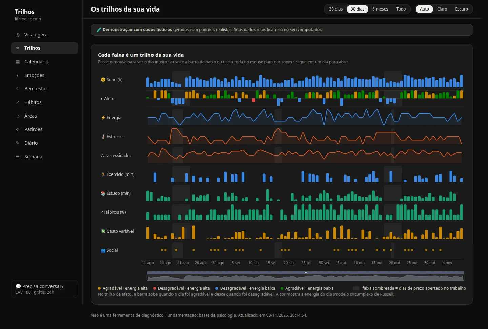
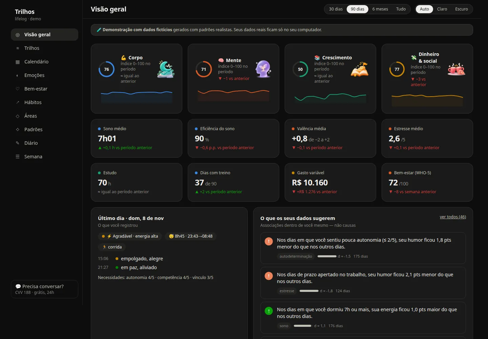
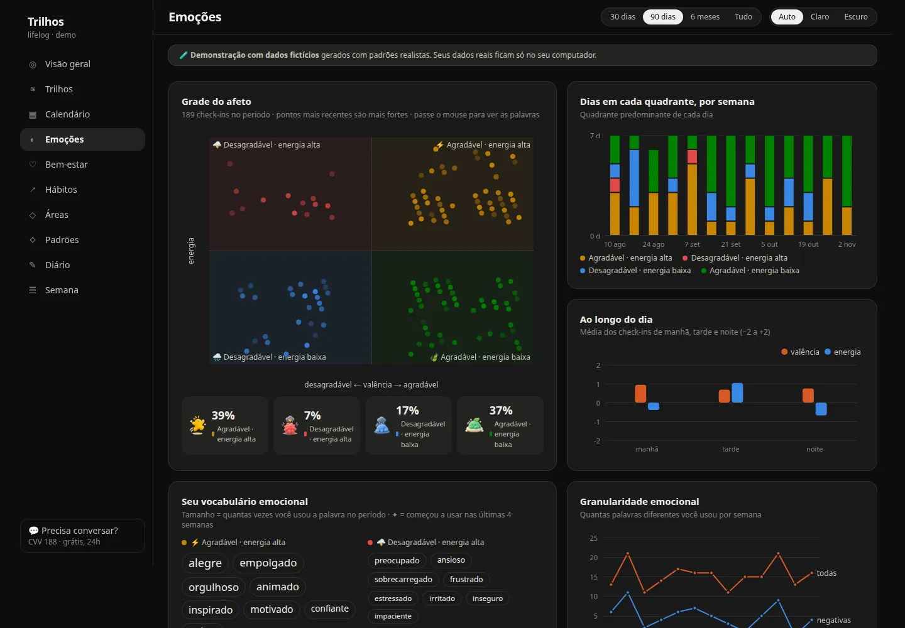
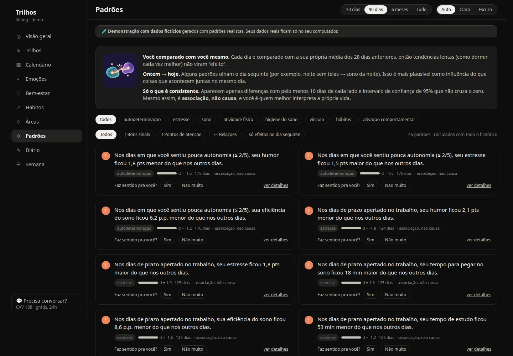
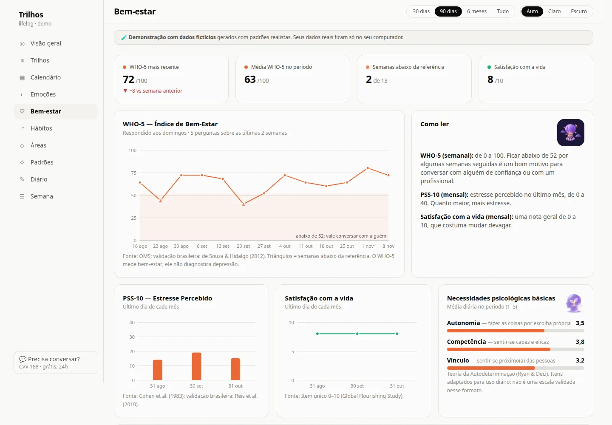
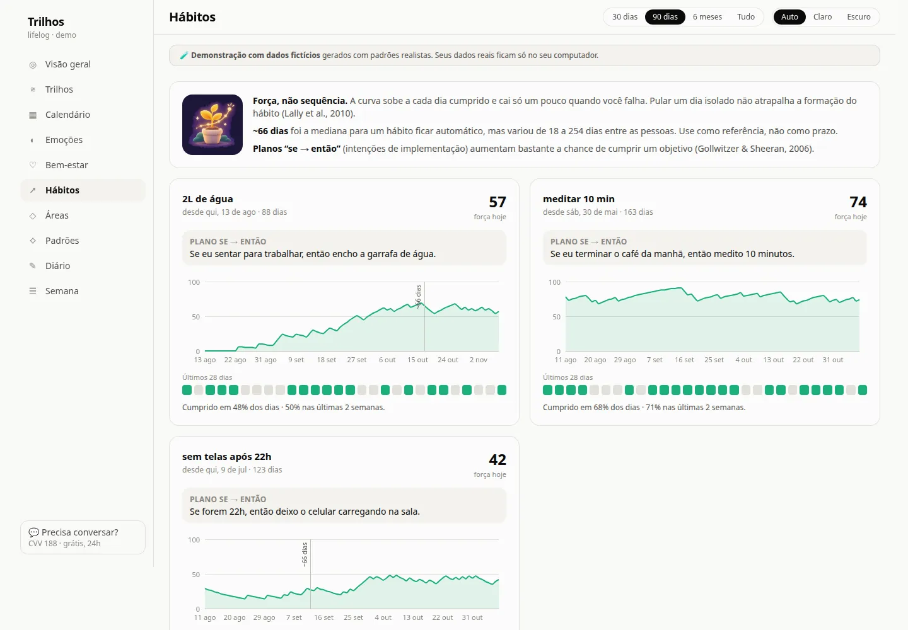
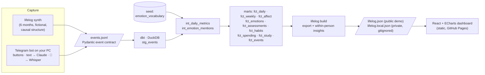

# lifelog-ai · Trilhos

> See the tracks of your life — sleep, emotions, habits, study, money and relationships — on one timeline,
> with patterns grounded in psychology research and honest statistics.

[](https://github.com/lucasnardivieira/lifelog-ai/actions/workflows/ci.yml)
[](https://lucasnardivieira.github.io/lifelog-ai/)

**Live demo (fictional data, UI in PT-BR):** https://lucasnardivieira.github.io/lifelog-ai/



| Overview | Emotions (circumplex) | Within-person patterns |
|---|---|---|
|  |  |  |
| **Well-being (WHO-5, PSS-10)** | **Habits (strength + if-then)** | |
|  |  | |

## Problem
Self-tracking apps either track one thing in isolation (a sleep app, a budget app, a mood app) or turn a
life into gamified streaks. I wanted one place to see how the tracks of my life **interact** — does a
deadline week wreck my sleep? Do evenings without screens actually help? — measured with **validated
constructs** and analyzed **within-person**, without pretending correlations are causes.

## What it measures (and why)
Every identifier comes from the literature — full notes, sources and caveats in
[docs/research/psychology-foundations.md](docs/research/psychology-foundations.md).

| Construct | Identifier | Cadence |
|---|---|---|
| Core affect — Russell's circumplex | valence × arousal (−2…+2), 4 quadrants | check-ins |
| Emotional granularity — Barrett, Kashdan | PT-BR emotion words (40-word vocabulary) | with each check-in |
| Sleep — Consensus Sleep Diary | bedtime, sleep-onset latency, awakenings, wake time, quality → efficiency, regularity | mornings |
| Basic needs — Self-Determination Theory | autonomy, competence, relatedness | evenings |
| Well-being / stress / life satisfaction | WHO-5, PSS-10 (both validated in BR-PT), 0–10 item | weekly / monthly |
| Behavioral activation | pleasure & mastery on activities | optional |
| Habits — Lally; implementation intentions — Gollwitzer | habit strength curve + if-then plan | daily |

**Patterns** compare each day with *your own* trailing 28-day baseline (detrended), include next-day (lag-1)
effects, require ≥ 10 days per group and a bootstrap 95% CI that excludes zero, and are always labeled
*association, not cause*. **Safety:** nothing is diagnostic; CVV 188 / SAMU 192 are always one click away and
highlighted after a low WHO-5.

## Architecture


- **One event contract** (`src/lifelog/events.py`) for every source — the dashboard doesn't care whether data is synthetic or real.
- **dbt** does the modeling: sleep efficiency & midpoint regularity, questionnaire scoring (PSS-10 reverse items in SQL), weekly granularity, 0–100 area scores; 40+ data tests.
- **Insights** (`src/lifelog/insights.py`): detrended group comparisons (Cohen's d + bootstrap CI) and correlations, phrased in PT-BR.
- **Dashboard** (`web/`): 10 views — overview, tracks timeline, calendar heatmap, emotions, well-being, habits, areas, patterns, diary, weekly report. Light/dark themes; colors from a CVD-validated palette, never color-alone.

## Tech stack
Python 3.12 · uv · Pydantic · dbt-core + dbt-duckdb · DuckDB · python-telegram-bot · Claude (Haiku 5.5, structured outputs) · faster-whisper · pytest · ruff · React 19 · TypeScript · Vite · Tailwind CSS v4 · Apache ECharts · Vitest · GitHub Actions · GitHub Pages
(Planned: optional private cloud via Terraform.)

## How to run
Requires [uv](https://docs.astral.sh/uv/) and Node 24.
```bash
make setup
make test        # pytest + vitest
make synth       # 6 months of fictional events
make build       # dbt build + export the dashboard JSON
make dev         # http://localhost:5173
```

### Telegram bot — log your real life (M6, runs on your PC)
1. In Telegram, talk to **@BotFather** → `/newbot` → copy the token.
2. `cp .env.example .env` and set `TELEGRAM_BOT_TOKEN` and `ANTHROPIC_API_KEY`.
3. `make bot`, then send `/start` to your bot. It replies with your chat id. Put it in
   `TELEGRAM_ALLOWED_CHAT_ID`, restart with `make bot` (or `make bot-voice` for audio messages).
4. Write freely ("dormi 6h30, acordei cansado", "gastei 42 no almoço"), send 🎤 audio, or use the
   button check-ins: `/sono`, `/checkin`, `/fechar`, `/who5`, `/pss10`. Every free-text extraction is shown
   as a preview that you confirm before it's saved. `/desfazer` undoes the last save. The private dashboard rebuilds itself after every save and the open page refreshes live (no `/painel` needed).

Reminders: sleep diary at 08:00, affect check-in at 15:00, WHO-5 on Sundays at 20:00, PSS-10 + life
satisfaction on the last day of the month. Messages sent while the PC is off are processed when the bot
starts again. `make eval` scores the Claude extraction on a golden set of 30 PT-BR messages: **100% event types, 100% field accuracy** with Claude Haiku 5.5 at ~US$0.0003 per message (2026-11-10).

### Private dashboard online (optional)
See it from your phone behind a login (Cloudflare Pages + Cloudflare Access, free):
[docs/private-dashboard.md](docs/private-dashboard.md). The bot refuses to upload anything until you confirm Access is protecting the site.

### With your own data (stays on your machine)
Put events in `data/private/events.jsonl` (same contract), then:
```bash
make private     # → web/public/data/lifelog.local.json (gitignored); the app prefers it over the demo
make dev
```

## Cost & teardown
**US$0** — DuckDB runs locally and the demo is a static GitHub Pages site rebuilt weekly by Actions.
Teardown: disable Pages (Settings → Pages). The Terraform in `infra/` is only for the optional private
online view (M7) and contains no resources yet; `make destroy` removes anything it creates.

## What I learned
- Psychology research translates surprisingly well into data contracts: each construct became typed fields, a dbt model and a test.
- Within-person analysis changes the story: same-day correlations are easy; detrended, lag-aware comparisons with CIs are what survive.
- Synthetic data with *causal structure* is the best fixture — it exercises every chart and lets tests assert that the analysis recovers known effects.
- A CVD-validated palette and "never color-alone" constraints make dashboards calmer, not just more accessible.

## Roadmap
- [x] **M1** Event contract, synthetic data, dbt marts, within-person insights
- [x] **M2–M4** Dashboard: overview, tracks, calendar, emotions, well-being, habits, areas, patterns, diary, weekly report
- [x] **M5** Public demo on GitHub Pages, README, screenshots
- [x] **M6** Telegram bot on the PC: button check-ins (sleep diary, affect grid + words, needs, WHO-5, PSS-10), free text/voice → Claude → confirmed events, reminders, undo, crisis safety net
- [x] **M7a** Private online dashboard: Cloudflare Pages + Access (email/Google login), auto-published by the bot
- [ ] **M7b** Bot in the cloud (works with the PC off)

---
Illustrations generated with ChatGPT for this project. Not a medical device and not a diagnostic tool.
If you're going through a hard time in Brazil, call **CVV 188** (free, 24h).
