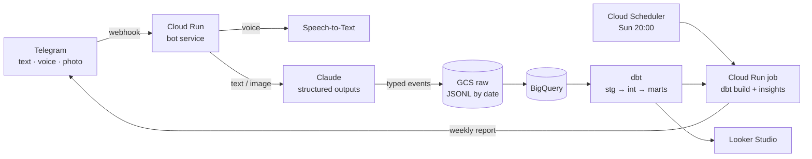

# lifelog-ai

> Text, voice or photo a Telegram bot about your day — Claude turns it into typed events, dbt turns them into insights.

[](https://github.com/lucasnardivieira/lifelog-ai/actions/workflows/ci.yml)

> 🚧 Work in progress — see [Roadmap](#roadmap).

## Problem
Tracking habits (sleep, spending, study, mood) usually dies because of friction: one app per habit, forms to fill.
Here, logging is a chat message — `"gastei 42 no almoço"`, `"dormi 6h, acordei cansado"`, `"estudei dbt 1h30"` — and
the structure is produced by an LLM, validated, and modeled like any other data source.

## Architecture


Event types (v1): `expense`, `sleep`, `mood`, `study`, `exercise`, `meal`, `note`. One message may yield several events.

## Tech stack
Python 3.12 · uv · ruff · pytest · python-telegram-bot · Anthropic Claude API (Haiku for extraction, Sonnet for insights) ·
Pydantic · DuckDB (local) · GCS · BigQuery · dbt · Terraform · Cloud Run · Cloud Scheduler · Secret Manager · GitHub Actions

## Data sources
Personal messages sent to a private bot. **This repo only ever contains synthetic data**
(`scripts/generate_synthetic.py`); real data lives in GCP, and the bot ignores any chat id other than the owner's.

## How to run
### Local
```bash
cp .env.example .env   # fill in the values
make setup
make test
make run               # polling mode, local DuckDB (M1)
```
### Cloud
```bash
make deploy    # terraform apply — creates billable resources
make destroy   # tear everything down
```

## Results / screenshots
_Coming with M4 (dashboard on synthetic data)._

## Cost & teardown
Expected **~US$0–3/month**: Cloud Run, Cloud Scheduler, BigQuery and Speech-to-Text stay within free tiers at personal volume;
Claude tokens cost cents. A GCP budget alert is recommended. Teardown: `make destroy` (see [infra/terraform/README.md](infra/terraform/README.md)).

## What I learned
_To be filled in as milestones ship._

## Roadmap
- [ ] **M1 Local MVP** — polling bot, Claude text extraction, local DuckDB, tests with recorded responses
- [ ] **M2 Evals** — golden set (~50 labeled messages), extraction accuracy in CI
- [ ] **M3 Deploy** — Terraform: Cloud Run webhook, GCS raw, Secret Manager
- [ ] **M4 Warehouse** — BigQuery + dbt marts + Looker Studio
- [ ] **M5 Weekly report** — Scheduler + Cloud Run job + Claude insights to Telegram
- [ ] **M6 Voice & photos** — Speech-to-Text, receipt photos via Claude vision, demo GIF
